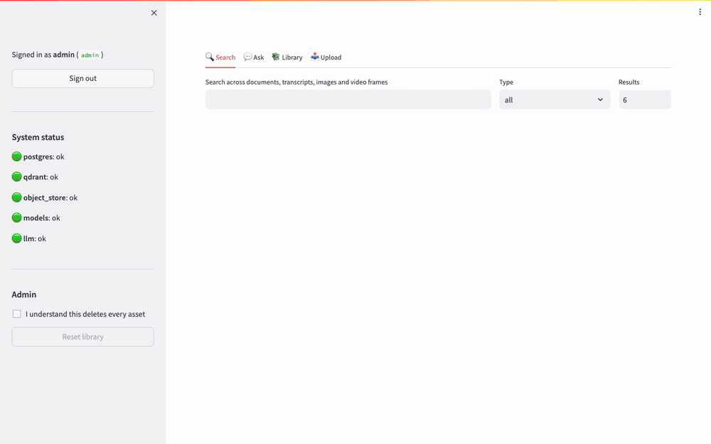
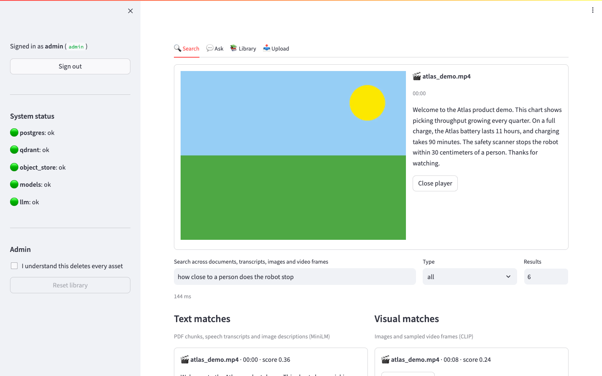
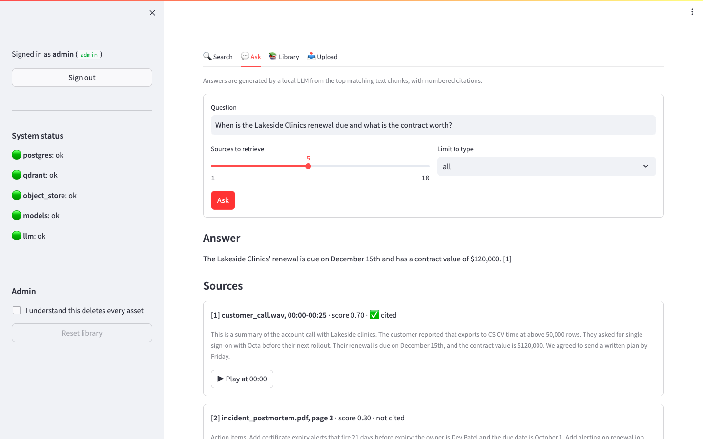
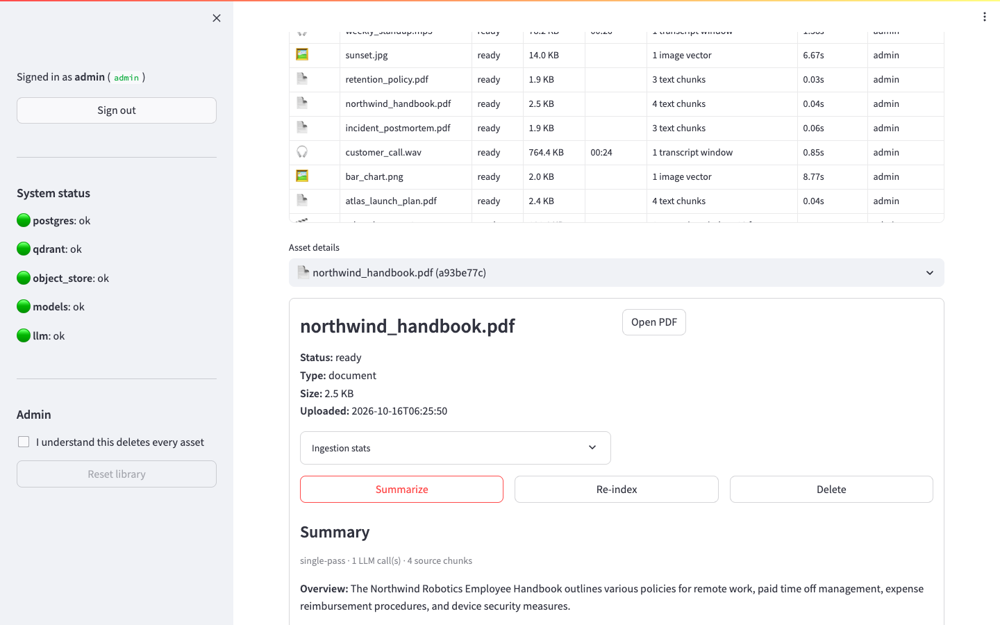
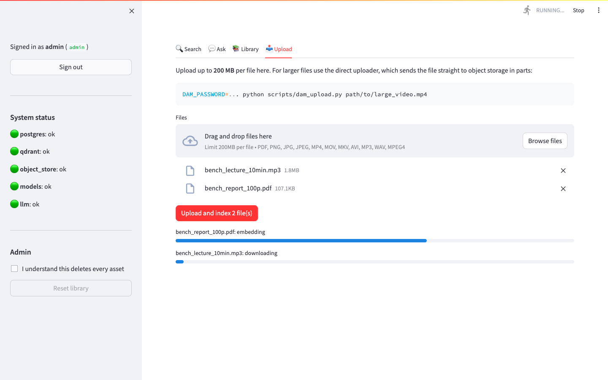
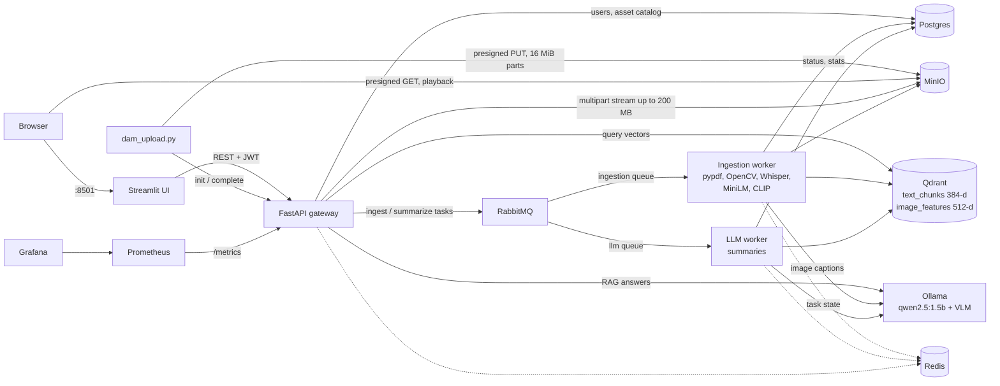
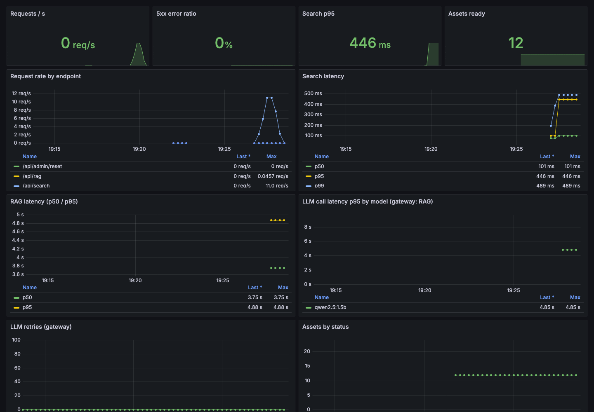

# Multimodal Digital Asset Management & RAG Platform

[](https://github.com/vipin-mo/multimodal-dam-rag-platform/actions/workflows/ci.yml)

Upload PDFs, images, audio and video. The platform extracts text, transcribes speech and samples
video frames, then indexes everything for semantic search. Search results open the media at the
matching timestamp or page. You can also ask questions and get answers from a local LLM, with
numbered citations back to the source.

Everything runs locally in Docker on CPU: FastAPI, Celery, Qdrant, Postgres, MinIO and Ollama.



## v1 → v2 results

v1 (Sep 2026, tag `v1.0`) was a working prototype. v2 (Oct 2026, tag `v2.0`) is a rewrite driven
by profiling v1. Both were measured with the same benchmark script. See
[docs/BENCHMARKS.md](docs/BENCHMARKS.md) for setup, method and caveats.

| | v1 | v2 |
|---|---:|---:|
| Ingest a 100-page PDF | 33.9 s | **3.1 s** (11×) |
| Ingest a 5-min video with speech | 30.5 s | **12.8 s** (2.4×) |
| Retrieval recall@5 / MRR, 22 questions with distractors | 0.864 / 0.723 | **0.955 / 0.932** |
| Search throughput at 8 concurrent clients | 15 req/s | **30 req/s** |
| Gateway memory growth during a 1 GB upload | +56 MiB (through the API) | **+0 MiB** (direct to storage) |
| Image size on disk: API / worker / UI | 11.7 GB each | **2.0 / 2.4 / 0.8 GB** |

## Project history

- **v1 (Sep 2026):** built the end-to-end pipeline: ingestion of PDFs, images, audio and video,
  two vector indexes, search, RAG and summaries in a Streamlit UI.
- **v2 (Oct 2026):** measured v1, found the bottlenecks and fixed them. This covered performance
  (batched local embedding, concurrent search), retrieval quality (sentence-aware chunking),
  security (secrets, auth, upload validation), reliability (background LLM worker, retry policy),
  a real test suite with CI, and new features: an asset catalog, direct large uploads, image
  captions, cited answers and deduplication.

To reproduce the comparison, check out each tag and run `scripts/benchmark.py`; v1 needs `--api legacy`.

## What it does

- **Ingestion.** Each file type gets its own pipeline, run on Celery workers fed by RabbitMQ:
  - **PDFs:** split into chunks of about 500 characters with overlap, labelled by page.
  - **Images:** CLIP vectors plus a vision-model caption, so they also match text search and RAG.
  - **Audio and video:** speech transcribed with faster-whisper, grouped into timestamped windows.
  - **Video frames:** one CLIP-embedded frame every 2 seconds.

  The UI shows live progress for each file.
- **Two vector indexes in Qdrant.**
  - `text_chunks` (384-d MiniLM) holds document chunks, transcripts and captions.
  - `image_features` (512-d CLIP) holds images and frames.

  A query searches both indexes at once, using CLIP's text encoder for the visual side.
- **Jump to the source.** Every hit carries its page or start/end time. Media streams from MinIO
  through short-lived presigned URLs, so the bytes never pass through the API.
- **RAG with citations.** The top chunks become numbered sources, and the LLM answers with inline
  `[n]` citations that link to the exact page or timestamp.
- **Summaries.**
  - Short assets get a single prompt; long ones get map-reduce (summarize the parts, then combine).
  - Images go to the vision model.
  - Summaries run on a separate LLM worker queue, and results are cached.
- **Asset catalog in Postgres.** It tracks status, ingestion stats, captions and summaries, and
  supports delete (object, vectors and catalog row) and re-index.
- **Duplicate detection.** Every file is identified by its SHA-256. Uploading content that is
  already in the library returns `409` with the existing asset, unless `allow_duplicate=true`.
  The direct uploader sends the hash first, so a duplicate is rejected before any bytes are sent,
  and the worker re-hashes the stored object as an integrity check.
- **Large files.** Presigned multipart uploads go straight to object storage
  (`scripts/dam_upload.py`). Memory stays bounded by the part size whatever the file size.
- **Monitoring (optional).** Prometheus and a provisioned Grafana dashboard show request rate, p95
  latency, LLM latency and retries for RAG calls, and asset counts. The Celery workers are not
  scraped.

## Screenshots

| Search → play at the matching moment | RAG answer with citations |
|---|---|
|  |  |
| **Library: asset details and summary** | **Batch upload with live progress** |
|  |  |

## Architecture



There are 10 long-running containers, plus a one-shot `ollama-init` that pulls the models.
Prometheus and Grafana add 2 more under the `monitoring` profile.

| Service | Role |
|---|---|
| `api-gateway` | FastAPI: auth, uploads, catalog, search, RAG. Embeds queries locally. |
| `ingestion-worker` | Celery, queue `ingestion`: parse, transcribe, sample, embed, upsert |
| `llm-worker` | Celery, queue `llm`: summaries (can take minutes on CPU), kept away from ingestion |
| `frontend-ui` | Streamlit |
| `vector-db` | Qdrant |
| `postgres-db` | Users and the asset catalog |
| `minio` | S3-compatible object storage |
| `rabbitmq` | Celery broker |
| `redis-cache` | Celery result backend: task state and progress |
| `ollama-engine` | Local LLM and vision model |

### Design decisions

- **The worker embeds locally.** v1 sent every text chunk to the gateway over
  HTTP: one call per PDF line, on an unauthenticated endpoint. Removing that hop made PDFs about
  9× faster with the same thread budget and closed the security hole.
- **Vectors are keyed by asset ID, with deterministic point IDs.** Re-indexing deletes and rewrites
  an asset's points, so retries and re-uploads never create duplicates.
- **Long LLM work runs off the request path.** A 100-page map-reduce summary is about 20 LLM calls,
  3–6 minutes on CPU. The API returns `202` with a task ID, and a single-concurrency worker
  matches Ollama's one-request-at-a-time serving.
- **LLM retries are selective.** Connection errors and 5xx get exponential backoff with jitter (for
  cold starts). Read timeouts are not retried, because Ollama keeps generating for the abandoned
  request and a retry only queues more work behind it. Every call has a token cap.
- **Liveness and readiness are separate.** `/health` answers as soon as the process is up.
  `/ready` checks Postgres, Qdrant, MinIO and whether the embedding models have finished loading
  in the background, so slow cold starts don't fail liveness probes.

## Quick start

You need Docker with about 8 GB of memory (about 12 GB with the default `llava:7b` vision model).

```bash
git clone https://github.com/vipin-mo/multimodal-dam-rag-platform.git
cd multimodal-dam-rag-platform
./scripts/init-env.sh            # writes .env with random secrets; prints the admin and viewer logins
docker compose up -d --build     # first start pulls about 6 GB of models
```

| URL | What |
|---|---|
| http://localhost:8501 | UI. Log in with the admin credentials printed by `init-env.sh`. |
| http://localhost:8000/docs | OpenAPI docs. The "Authorize" button works with the same login. |
| http://localhost:9001 | MinIO console |
| http://localhost:6333/dashboard | Qdrant dashboard |

On lower-memory machines, set `OLLAMA_VISION_MODEL=moondream` in `.env`. That model is 1.8B
parameters instead of 7B.

**Upgrading from v1:** the schema, storage keys and vector payloads changed. Start from empty
volumes with `docker compose down -v`, then `up` again. Otherwise the old Postgres volume keeps
the v1 accounts, and the new admin from `.env` is never created.

**Try it with the sample corpus:**

```bash
python -m pip install -r requirements/dev.txt   # or just: pip install httpx
DAM_PASSWORD=<admin password> python scripts/benchmark.py ingest --dir samples/corpus
```

Then try these searches in the UI: *"how close to a person does the robot stop"*, *"a sunset over
the ocean"*, or ask *"When is the Lakeside Clinics renewal due?"*.

**Upload a large file** (up to 5 GB by default):

```bash
DAM_PASSWORD=<admin password> python scripts/dam_upload.py path/to/video.mp4
```

**Monitoring:** run `docker compose --profile monitoring up -d`. Grafana is at
http://localhost:3000 (user `admin`, password from `GRAFANA_ADMIN_PASSWORD`) and comes with a
**DAM Gateway** dashboard.



## API

| Method & path | Role | |
|---|---|---|
| `POST /api/token` | – | OAuth2 password form; returns a JWT |
| `GET /api/me` | any | Current user |
| `POST /api/upload` | admin | Multipart upload (≤ `MAX_UPLOAD_MB`); `202` with asset ID and task ID, `409` if the content is already stored |
| `POST /api/uploads/init` · `/{id}/complete` · `/{id}/abort` | admin | Presigned direct-upload lifecycle |
| `GET /api/assets` · `/{id}` · `/{id}/url` | any | Catalog list (with filters), detail, presigned media URL |
| `DELETE /api/assets/{id}` · `POST /api/assets/{id}/reindex` | admin | Remove everything for the asset / re-run ingestion |
| `GET /api/search?query=&media_type=&asset_id=&limit=` | any | Text and visual search in one call |
| `POST /api/rag` | any | `{question, top_k, media_type?}`; returns the answer, numbered sources and cited numbers |
| `POST /api/assets/{id}/summary` | any | `200` with the cached summary, or `202` with a task ID; `?refresh=true` is admin-only |
| `GET /api/tasks/{task_id}` | any | `PENDING` / `PROGRESS` (percent and stage) / `SUCCESS` / `FAILURE` |
| `POST /api/admin/reset` | admin | Deletes all objects, vectors and catalog entries |
| `GET /health` · `GET /ready` · `GET /metrics` | – | Liveness, readiness, Prometheus metrics |

## Security

- **Secrets.** There are no secrets in code or compose. Everything is read from `.env`, which is
  gitignored, and services refuse to start without them. The first admin is seeded from
  `ADMIN_PASSWORD`. Manage users with
  `docker compose exec api-gateway python -m app.database create-user <name> --role viewer`.
- **Auth.** JWTs are HS256 with a secret of at least 32 characters and are accepted only in the
  `Authorization` header. Roles are re-read from the database on every request.
- **Roles.** `admin` can upload, delete, re-index, reset and regenerate summaries. `viewer` can
  search, ask questions and read summaries (or request one that doesn't exist yet), but can't change
  the library. `init-env.sh` creates both accounts; pass `--no-viewer` to create only the admin.
- **Uploads.** Filenames are reduced to a safe basename stored under a per-asset UUID prefix.
  Uploads pass an extension allowlist and a magic-byte check, both at upload and again in the
  worker, and size limits are enforced before and while reading. The worker verifies the stored
  object's SHA-256 against the hash recorded at upload.
- **Network.** CORS is limited to `CORS_ORIGINS`. Postgres and Redis aren't published to the host,
  and other ports bind to 127.0.0.1 by default. Redis requires a password. The application containers (API, both
  workers, UI) run as a non-root user. MinIO runs as root in Compose so it can write to its named
  volume.
- **v1 credentials.** v1 commits contained hardcoded local-development credentials
  (`admin123`, `guest:guest`, MinIO keys). They were only ever used in local Docker, and nothing
  in the current code accepts them.

## Testing

```bash
pip install --index-url https://download.pytorch.org/whl/cpu torch==2.14.0
pip install -r requirements/dev.txt
ruff check . && ruff format --check .
pytest --cov                          # 134 unit tests, no network, ~12 s
./scripts/run-integration-tests.sh    # 9 integration tests against real Qdrant, Postgres and MinIO
```

- **Unit tests** run against in-memory SQLite with faked S3, Qdrant, Celery and LLM clients. They
  cover:
  - JWT edge cases: expired, forged and `alg=none` tokens, and tokens in the query string
  - RBAC on every admin route
  - path-traversal filenames, content sniffing and size limits
  - whitespace, control-character and injection-style queries
  - citation parsing, LLM retry policy and map-reduce
  - the worker pipelines, using real pypdf, OpenCV and Pillow on generated files
- **Integration tests** use the real MiniLM, CLIP and Whisper models and real services. They
  check ingestion, text-to-image search, transcript timestamps, idempotent re-indexing, delete,
  the presigned upload round-trip and media streaming. Only the LLM is faked.
- **CI** (GitHub Actions) runs lint, unit and integration tests, and builds all three images.

## Limitations

- **Small CPU models.**
  - qwen2.5:1.5b answers short factual questions well. It often fails to say "I don't know" (the
    API catches citation-only replies) and can garble multi-part answers.
  - Whisper `tiny` mis-hears names, for example "Okta" as "Octa". Set `WHISPER_MODEL_SIZE=small`
    for better accuracy at about 4× the time.
  - Small vision models (moondream) sometimes describe details that aren't in the image.
- **No OCR.** Scanned PDFs without a text layer are counted in `pages_without_text` but not
  indexed.
- **Slow summaries for long documents.** A 100-page PDF takes 3–6 minutes on CPU. With
  `OLLAMA_MAX_LOADED_MODELS=1`, the first caption after a RAG query also waits while Ollama
  swaps models.
- **Streamlit holds UI uploads in memory**, hence the 200 MB UI cap. Use the direct uploader
  for anything larger.
- **The eval set is small and synthetic**: 22 questions over a corpus I wrote. It shows the
  pipeline works and that chunking helped. It isn't a general retrieval benchmark.
- **Single-node Docker Compose.** There are no Kubernetes manifests.

## Project layout

```
app/
  main.py        API gateway (routes)       processor.py  Celery tasks: ingestion + summaries
  security.py    JWT + RBAC                 summaries.py  summary strategies
  database.py    users + asset catalog      chunking.py   sentence chunks, transcript windows
  storage.py     MinIO / presigned URLs     embeddings.py MiniLM + CLIP (lazy, batched)
  vectors.py     Qdrant collections         llm.py        Ollama client, RAG prompt, map-reduce
  media.py       allowlist, sniffing        config.py     environment settings
  ui.py          Streamlit front end
scripts/         init-env, dam_upload, benchmark, sample corpus, integration runner
eval/            retrieval questions        benchmarks/   raw benchmark results
monitoring/      Prometheus + Grafana       tests/        unit + integration
```

## License

MIT. See [LICENSE](LICENSE).
